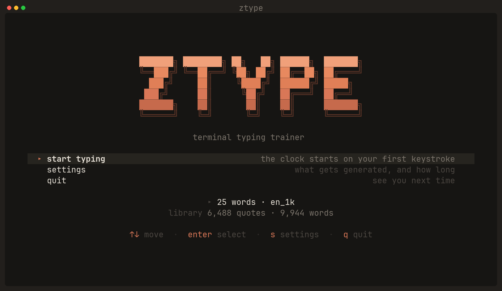
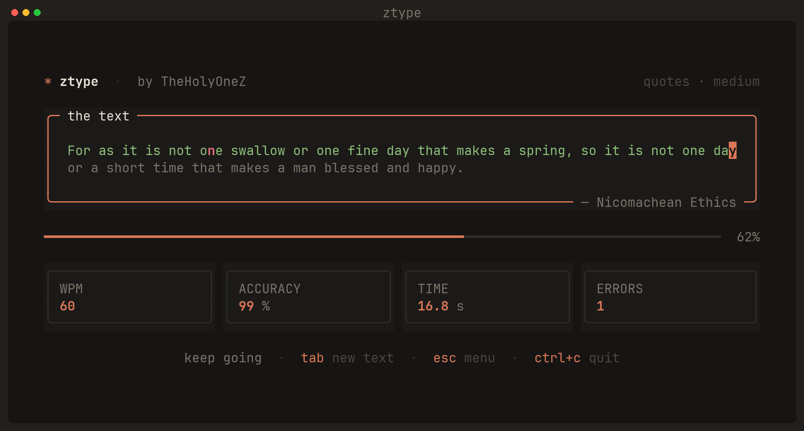
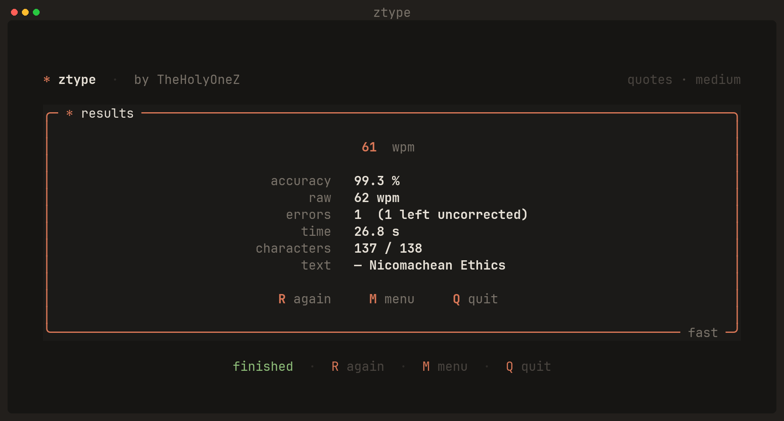
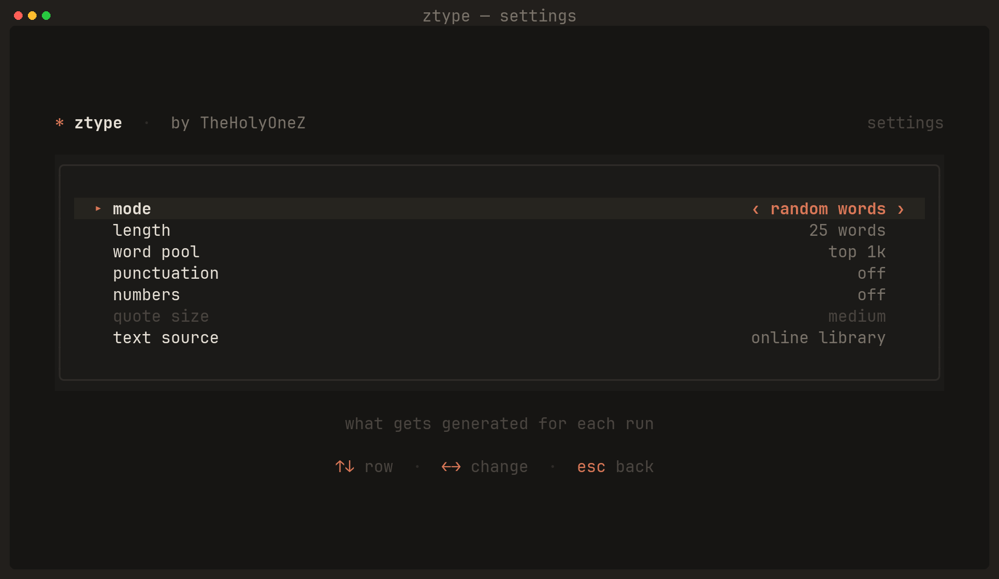

> More Projects at https://zsync.eu


<div align="center">

# ZTYPE

**A terminal typing trainer with a warm, modern TUI.**

by [TheHolyOneZ](https://github.com/TheHolyOneZ)

[](LICENSE)
[](https://www.python.org/)
[](https://textual.textualize.io/)



</div>

---

## What it is

A typing-speed tester that runs entirely in your terminal. It draws from a library of
**6,000+ real quotes** and word lists of up to **10,000 words**, so you practically never
get the same text twice. Live WPM and accuracy update as you type, and the clock only
starts when you hit your first key.

- **Character-accurate feedback** — correct letters go green, mistakes go red, and the
  cursor is a solid block. Characters never shift position, so the text can't reflow
  under your fingers mid-word.
- **Three modes** — random words, real quotes with sources, or hand-written passages.
- **Configurable** — length, word pool difficulty, punctuation, numbers, quote size.
- **Never repeats** — quotes you've seen are remembered across sessions.
- **Works offline** — the library caches locally, with built-in fallbacks if you've
  never been online.
- **Zero config** — no API keys, no accounts, no telemetry.

## Typing

The clock starts on your first keystroke, not when the screen appears. Until then the
panel border stays dim and the stats read `--`.



## Results



## Settings

Press `s` from the menu. Options that don't apply to the current mode grey out and
refuse to change — here `quote size` is inactive because the mode is *random words*.
Everything saves as you go.



## Install

```bash
git clone https://github.com/TheHolyOneZ/ztype.git
cd ztype
python3 -m venv .venv
.venv/bin/pip install -r requirements.txt
.venv/bin/python ztype.py
```

> **Arch, Debian 12+, Fedora and other PEP 668 distros** block installing into the system
> Python, so the virtual environment above isn't optional. If you'd rather install
> globally anyway, use `pipx` or `pip install --user --break-system-packages`.

Requires **Python 3.9+**. Dependencies are just [Textual](https://textual.textualize.io/)
and [Rich](https://rich.readthedocs.io/).

## Keys

| Screen | Key | Action |
|---|---|---|
| **Menu** | `↑` `↓` | Move selection |
| | `enter` | Select |
| | `s` | Settings |
| | `q` | Quit |
| **Settings** | `↑` `↓` | Change row |
| | `←` `→` | Change value |
| | `esc` | Back to menu |
| **Typing** | *any key* | Start the clock and type |
| | `backspace` | Fix the character behind the cursor |
| | `tab` | Draw fresh text |
| | `esc` | Back to menu |
| | `ctrl+c` | Quit |
| **Results** | `r` | Go again with new text |
| | `m` | Back to menu |
| | `q` | Quit |

The mouse works too — hovering a menu or settings row selects it, clicking activates it.

## Options

| Option | Values | Notes |
|---|---|---|
| `mode` | random words · real quotes · curated passages | What gets generated |
| `length` | 10 / 25 / 50 / 100 words | Words mode only |
| `word pool` | top 200 / 1k / 5k / 10k | Bigger pools mean rarer, harder words |
| `punctuation` | off / on | Capitals, commas, full stops, parentheses |
| `numbers` | off / on | Mixes digits into the word stream |
| `quote size` | short / medium / long / any | Quote mode only |
| `text source` | online library / offline built-ins | Fetch from the dataset, or stay local |

Settings live in `~/.config/ztype/settings.json`.

## Where the text comes from

ZTYPE pulls from [Monkeytype's](https://github.com/monkeytypegame/monkeytype) public
dataset — 6,488 English quotes with sources and length buckets, plus frequency-ordered
word lists at 200 / 1k / 5k / 10k words. No API key, no account.

The download (~2.4 MB) happens once, on a background thread so the menu stays responsive,
and lands in `~/.cache/ztype/`. After that, startup reads from cache in about 10 ms.

**On never seeing the same text twice:** quote IDs you've been served are recorded in
`~/.cache/ztype/seen.json` and only reset once you've worked through the entire library.
Word mode composes fresh text every run, so repeats are effectively impossible.

If the network is unreachable and nothing is cached, ZTYPE falls back to a built-in word
list and eight hand-written passages rather than failing.

## How the numbers work

A "word" is five characters, the standard convention.

- **WPM** (net) — counts only characters that ended up correct.
- **Raw** — counts every keystroke, right or wrong.
- **Accuracy** — correct keystrokes ÷ total keystrokes. Backspacing fixes your WPM but
  not your accuracy: the bad keystroke still counts, the same way Monkeytype scores it.
- **Errors** — total mistakes made, with uncorrected ones reported separately.

## Credits

- Quote and word data from [Monkeytype](https://github.com/monkeytypegame/monkeytype)
  (GPL-3.0). ZTYPE fetches it at runtime and does not bundle or redistribute it.
- Built with [Textual](https://textual.textualize.io/) and
  [Rich](https://rich.readthedocs.io/) by [Textualize](https://www.textualize.io/).

## License

[MIT](LICENSE) © 2026 TheHolyOneZ
